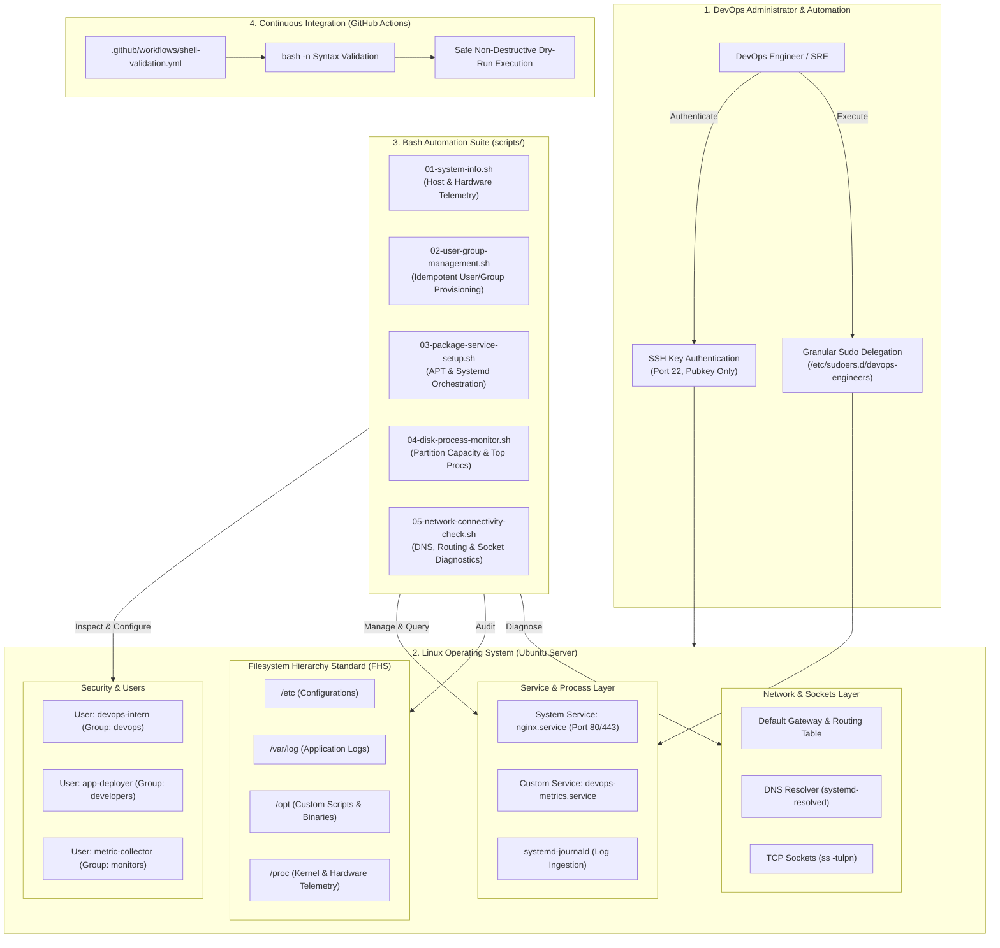

# 🏗️ Linux VM Deployment & Administration - Architecture & Design

## 1. System Overview

In modern Cloud and DevOps engineering, Linux serves as the underlying operating system for container hosts (Docker, Kubernetes nodes), virtual machines, CI/CD runners, and edge computing gateways. 

This project establishes the core architectural domains of Linux system administration:
1. **User and Identity Security**: Least-privilege role segregation (`devops`, `developers`, `monitors`) with hardened sudoers delegation.
2. **Systemd Service Architecture**: Custom daemon creation, restart policies, and resource isolation.
3. **Filesystem Organization & Storage Management**: Filesystem Hierarchy Standard (FHS) adherence and proactive capacity monitoring.
4. **Networking & Sockets**: Ingress traffic routing, port binding, and DNS resolution diagnostics.
5. **Continuous Verification (CI)**: Automated static script syntax validation via GitHub Actions without requiring cloud spend.

---

## 2. High-Level System Architecture Diagram

---

## 3. Core Architectural Domains

### A. Identity & Access Management (IAM)
- **Root Account Lockdown**: Root login via SSH is disabled (`PermitRootLogin no` in `sample-configs/sshd_config_example`).
- **Group Separation**:
  - `devops`: Operations engineers with specific sudo rights for service restarts.
  - `developers`: Application deployers restricted to application home paths.
  - `monitors`: Unprivileged daemon service accounts with login disabled (`/usr/sbin/nologin`).
- **Least-Privilege Sudo**: Commands are explicitly defined in `/etc/sudoers.d/` rather than granting full root access (`ALL=(ALL) ALL`).

### B. Daemon & Process Architecture
- Custom system services are managed through native systemd unit files (`sample-configs/sample-systemd.service`).
- Sandboxing features applied:
  - `ProtectSystem=strict`: Mounts `/usr`, `/boot`, and `/etc` read-only for the service.
  - `ProtectHome=true`: Prevents the service from reading `/home`.
  - `NoNewPrivileges=true`: Disallows privilege escalation via SUID binaries.

### C. Monitoring & Alerting Strategy
- Threshold-based partition monitoring catches runaway logs before disk exhaustion causes kernel panics or filesystem corruption.
- Process tracking isolates runaway CPU or Memory leaks using formatted `ps` queries.

### D. Quality Gate via CI/CD
- Shell scripts are checked automatically in GitHub Actions using `bash -n` to catch unmatched quotes, syntax errors, and invalid control flow before code merges to production branches.
